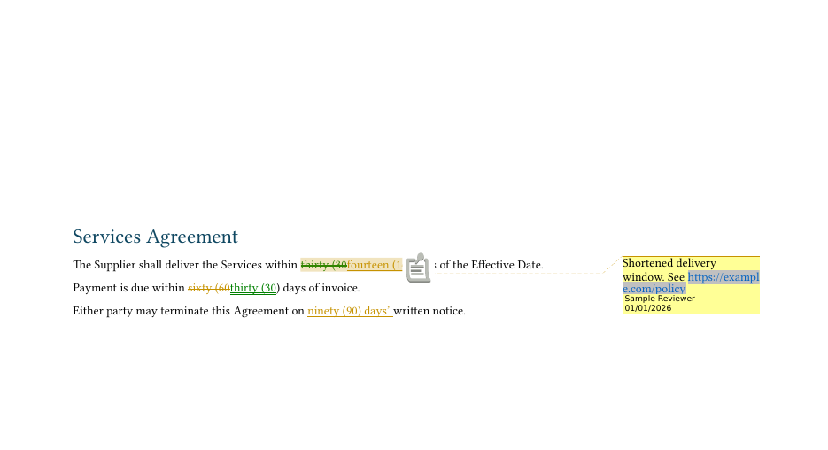

# docx-suggest

Turn any two drafts (docx, md, org) into a Word suggestions copy: tracked changes plus comments with clickable links.



The diff itself comes from [docdiff](https://github.com/davidawad/docdiff); docx-suggest only renders it. Accept-all reproduces the revised document and reject-all reproduces the base (checked before the file is written).

## Install

Requires `docdiff` on PATH (or `DOCDIFF_BIN`), and `pandoc` for `.md` / `.org` inputs.

```sh
cargo install --git https://github.com/davidawad/docx-suggest
```

## Quick start

A made-up services agreement with typos, a wrong year and one reworded clause lives in `examples/sample/` (regenerate with `examples/make-sample.sh`):

```sh
docx-suggest examples/sample/base.docx examples/sample/revised.md -o suggestions.docx \
  --comments examples/sample/notes.json --onto base
```

## Usage

```sh
docx-suggest base.docx revised.docx -o suggestions.docx
docx-suggest base.docx revised.md -o suggestions.docx --onto base   # keep the other side's package
docx-suggest base.docx revised.docx -o out.docx --comments notes.json
docx-suggest base.docx revised.docx -o out.docx --diff diff.json    # precomputed `docdiff --emit`
```

| Option | Env fallback | Default |
| --- | --- | --- |
| `--author` | `DOCX_SUGGEST_AUTHOR` | `docx-suggest` |
| `--email` (written to `word/people.xml`) | `DOCX_SUGGEST_EMAIL` | none |
| `--initials` | `DOCX_SUGGEST_INITIALS` | first letters of author |
| `--onto revised\|base` | | `revised` |

Reproduce the screenshot: `docs/showcase/make-screenshots.sh` (see `docs/showcase.md`).

## Tests

`cargo test` (needs `docdiff` on PATH or `DOCDIFF_BIN`).

## License

MIT. See `LICENSE`.
